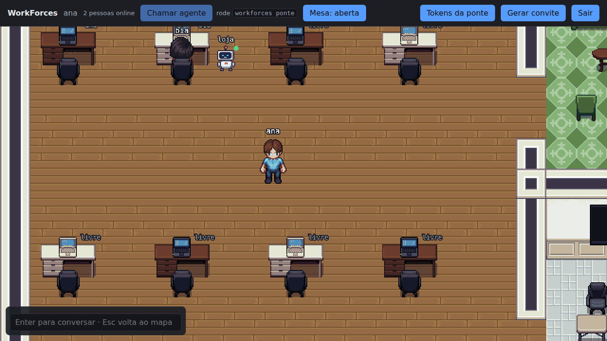

# WorkForces

Escritório virtual 2D para times que trabalham com agentes de código (Claude Code). Cada pessoa entra pelo app de desktop (Windows). Cada agente roda na máquina de quem o chamou; quem chega perto da mesa vê o terminal do agente ao vivo, só para leitura.



> Em construção.

## Desenvolvimento

Requisitos: Node 22.12 ou mais novo e pnpm 12 (`npm install -g pnpm@12.11.2`).

```bash
pnpm install
pnpm typecheck
pnpm build
pnpm test
```

`pnpm e2e` sobe o servidor, a ponte e o app (Electron) do build, e `pnpm demo` grava o GIF deste README. Os dois pesam na CPU e rodam na esteira do GitHub: o E2E no CI, e o GIF no workflow manual "GIF do README". No Linux sem tela, rode com `xvfb-run -a`.

## Rodar o escritório localmente

```bash
pnpm build
node packages/server/dist/cli.js start
```

Em outro terminal, abra o app com `pnpm app`. Na primeira execução, o console do servidor mostra um link de convite de admin (válido por 24 h). No app, cole o link em "Entrar com convite" e crie a primeira conta. O escritório fica salvo, e nas próximas vezes o app já abre nele.

O app é o único jeito de entrar. O servidor não serve mais páginas para o navegador, só a API, o mapa e a página do link de convite, que abre o app.

### No escritório

- Ande com as setas ou WASD. Pare perto de uma cadeira (ou do sofá) para sentar; qualquer tecla de movimento (setas ou WASD) levanta. Cada pessoa recebe uma mesa na primeira vez que aparece (pelo app ou pela ponte): a primeira livre, na ordem do mapa.
- Os agentes de cada pessoa aparecem como robôs na mesa dela, com o rótulo e o status. Robô esmaecido: o dono está fora ou a ponte está reconectando.
- Chegue perto de uma mesa com agentes para ver o terminal ao vivo, só leitura, com uma aba por agente. Com o painel aberto, a câmera desloca o mapa para você continuar à vista; ao se afastar, o painel fecha.
- Enter abre o chat; Enter manda; Esc volta ao mapa. O chat guarda só as últimas 200 mensagens, em memória: reiniciar o servidor apaga.
- **Mesa: aberta/fechada**, na barra de cima: com a mesa fechada, ninguém vê o terminal dos seus agentes (nem você, pelo mapa). Os robôs continuam na mesa, com a placa "fechada", e a escolha vale até você abrir de novo, mesmo que o servidor reinicie.

### Editar o mapa

O mapa é um arquivo do [Tiled](https://www.mapeditor.org/) (`assets/map/office.tmj`), com tiles de 32 px. Para o escritório entender o mapa:

- um único tileset, **embutido** no mapa, com a imagem na mesma pasta do `.tmj`;
- camadas de tiles com a propriedade booleana `collides` = `true` bloqueiam a passagem (paredes);
- as posições são as dos pés: o ponto no meio da base de quem (ou do que) está ali;
- um objeto do tipo `spawn` (ponto) marca a entrada;
- cada mesa é um retângulo do tipo `desk` (a zona onde quem chega vê o terminal), com um nome único em minúsculas (`mesa-1`, `mesa-2`…); a ordem das mesas no mapa é a ordem em que elas são distribuídas;
- até 3 pontos do tipo `robot` por mesa, com a propriedade `desk` = nome da mesa, marcam onde aparecem os robôs;
- pontos do tipo `seat`, com a propriedade `dir` (`up`, `down`, `left` ou `right`, para onde a pessoa olha), são assentos: quem para perto senta (a posição do assento é arredondada para pixels inteiros);
- pontos do tipo `prop`, com a propriedade `sprite`, desenham um móvel ou uma decoração com a base nesse ponto. Os nomes disponíveis estão em `packages/client/src/game/props.json`; os móveis bloqueiam a passagem pela base.

Se algo não bater, o servidor não sobe e diz o motivo. Um `sprite` que não existe no atlas só some do mapa, com um aviso no console das DevTools do app (F12, em desenvolvimento). Para usar outro mapa, aponte `WF_MAP` para ele.

**Arte.** A arte é do [LPC Revised](https://github.com/ElizaWy/LPC), sob a licença OGA-BY 3.0, com os créditos de cada peça em `assets/CREDITS.md`; o robô é desenho próprio. As imagens são geradas por `tools/art/build_art.py` (Python 3.10+ e [Pillow](https://pypi.org/project/pillow/)), que baixa as peças do LPC Revised de um commit fixado:

```bash
python tools/art/build_art.py          # refaz as imagens e o props.json
python tools/art/build_art.py --map    # também refaz o mapa (descarta edições feitas no Tiled)
```

Configuração por variáveis de ambiente:

| Variável | Padrão | Uso |
|---|---|---|
| `WF_PORT` | `4600` | porta do servidor |
| `WF_HOST` | `127.0.0.1` | interface em que escuta (`0.0.0.0` para a rede; defina também `WF_PUBLIC_URL` com o endereço que as pessoas abrem) |
| `WF_PUBLIC_URL` | `http://localhost:<porta>` | endereço público do escritório: vai nos links de convite e é a única origem aceita |
| `WF_DATA_DIR` | `~/.workforces-server` | onde fica o banco SQLite |
| `WF_MAP` | `assets/map/office.tmj` | mapa do escritório (Tiled, tiles de 32 px); a imagem do tileset fica na mesma pasta |
| `WF_INSECURE` | desligado (`1` liga) | permite `WF_PUBLIC_URL` com HTTP fora de localhost; o app só aceita HTTP em localhost, então quem está em outro computador não entra num servidor sem HTTPS |
| `WF_TRUST_PROXY` | desligado (`1` liga) | confia em `X-Forwarded-For` (atrás de um proxy reverso) |

Para desativar uma conta: `node packages/server/dist/cli.js user disable <nome>`.

Rode com as mesmas variáveis `WF_*` do servidor: o comando abre o banco em `WF_DATA_DIR` e valida `WF_PUBLIC_URL`.

### Conectar a ponte

No escritório, abra "Tokens da ponte", crie um token e rode na sua máquina:

```bash
node packages/bridge/dist/cli.js login http://localhost:4600
node packages/bridge/dist/cli.js claude
```

O escritório mostra os comandos como `workforces …`; sem instalar a ponte, use `node packages/bridge/dist/cli.js` no lugar de `workforces`.

### Chamar agente pelo escritório (Windows)

Libere as pastas que o escritório pode abrir e deixe a ponte ligada:

```bash
node packages/bridge/dist/cli.js pastas add ./meu-projeto --nome loja
node packages/bridge/dist/cli.js ponte
```

No escritório, "Chamar agente" lista as pastas liberadas. Escolher uma abre uma janela nova do Windows Terminal com `workforces claude` naquela pasta, e o robô aparece na sua mesa.

O servidor só conhece os apelidos, nunca os caminhos, e a ponte confere tudo de novo: no máximo um pedido a cada 5 s e 5 agentes abertos (contam os `workforces claude` desta instalação, incluindo os que a ponte abriu). É preciso ter o Windows Terminal, que já vem no Windows 11; no Windows 10, instale com `winget install Microsoft.WindowsTerminal`.

`pastas list` mostra as pastas liberadas, e `pastas rm <apelido>` tira uma da lista. Com a ponte ligada, a lista do escritório muda na hora.

### Servidor para um time (Docker + Caddy)

Para outras pessoas entrarem de outros computadores, o servidor precisa ficar numa máquina que todos alcancem, com HTTPS: fora de localhost, servidor e ponte recusam HTTP sem TLS, e o servidor avisa no log quando escuta na rede sem HTTPS. A pasta `deploy/` tem um exemplo com o [Caddy](https://caddyserver.com/) na frente, que gera e renova o certificado sozinho.

Numa máquina com Docker, as portas 80 e 443 livres e um nome no DNS apontando para ela:

```bash
cd deploy
WF_DOMAIN=escritorio.exemplo.com.br docker compose up -d --build
docker compose logs workforces   # o primeiro convite de admin aparece aqui
```

- As contas ficam no volume `workforces-data`. Para atualizar: `git pull` e o mesmo `docker compose up -d --build`; depois, quem estiver no escritório clica em "Escritórios" e entra de novo.
- Na primeira subida, o Caddy espera o servidor ficar saudável (uns 30 s) antes de responder.
- Use um domínio (ou subdomínio) só para o escritório: um site num domínio pai pode criar cookies que atrapalham o de sessão.
- Não publique a porta 4600 do servidor: só o Caddy fala com ele.
- Para usar no trabalho: só com aprovação de TI/segurança e num servidor interno.

**Rede interna, sem DNS público.** Troque o bloco do `deploy/Caddyfile` por um com certificado interno:

```text
{$WF_DOMAIN} {
    tls internal
    reverse_proxy workforces:4600
}
```

Depois, copie a CA do Caddy (`docker compose cp caddy:/data/caddy/pki/authorities/local/root.crt .`) e instale-a no Windows de quem usa o escritório, em "Autoridades de Certificação Raiz Confiáveis": o app confia nos certificados instalados no Windows, além dos que vêm com ele. Na ponte, aponte `NODE_EXTRA_CA_CERTS` para esse arquivo. Quando o convite levar o pino do certificado (num plano futuro do app), o app deixa de precisar desse passo.

Para testar só a imagem, sem o Caddy:

```bash
docker build -t workforces .
docker run -p 127.0.0.1:4600:4600 -e WF_PUBLIC_URL=http://localhost:4600 workforces
```

O log avisa que está sem HTTPS (dentro do container o servidor escuta na rede); publicar a porta só em `127.0.0.1` deixa o acesso restrito a este computador.

### O app em desenvolvimento

`pnpm app` abre o app a partir do build (`packages/app/dist` e `packages/client/dist`). Depois de mudar o cliente, rode `pnpm --filter @workforces/client build` (ou deixe `pnpm --filter @workforces/client dev` rodando) e aperte F5 na janela do app; F12 abre as DevTools. Ao abrir, o app registra o link `workforces://` neste Windows para esta cópia; é assim que o link de convite do navegador chega a ele.
